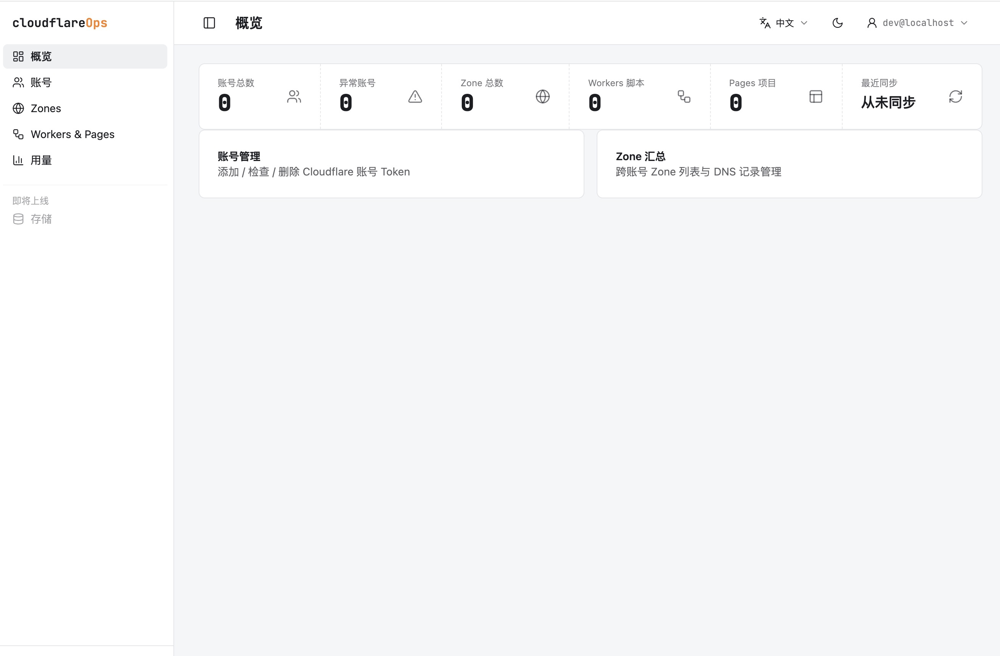
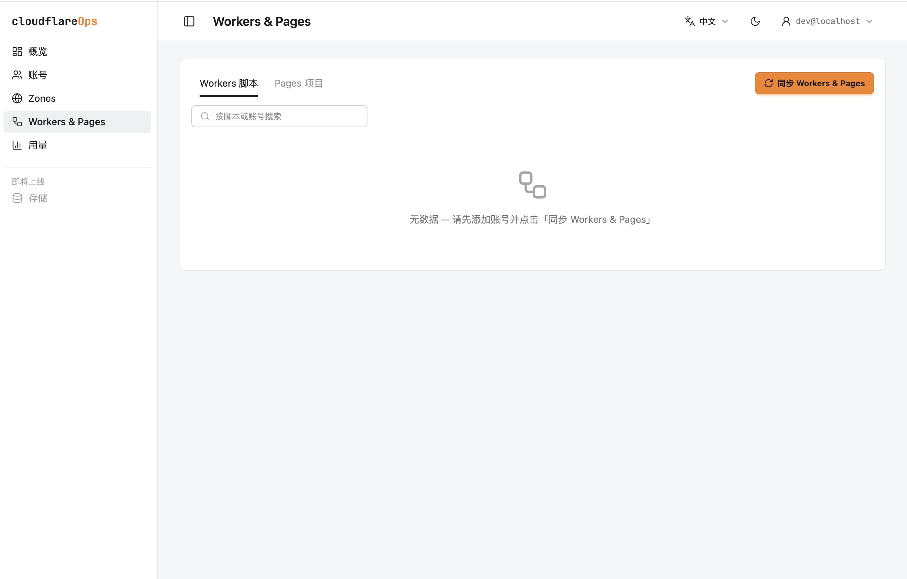
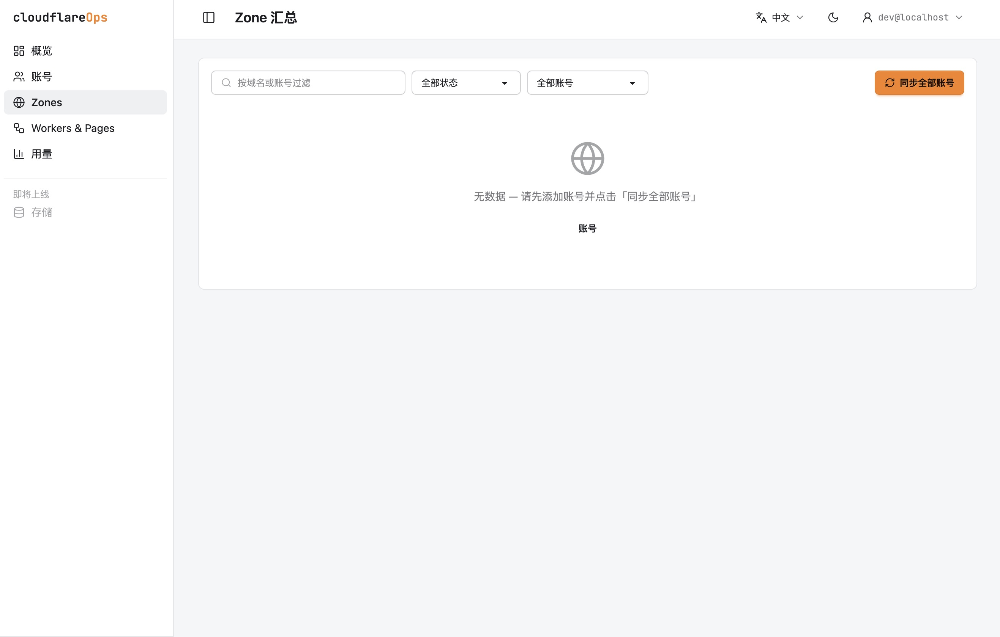
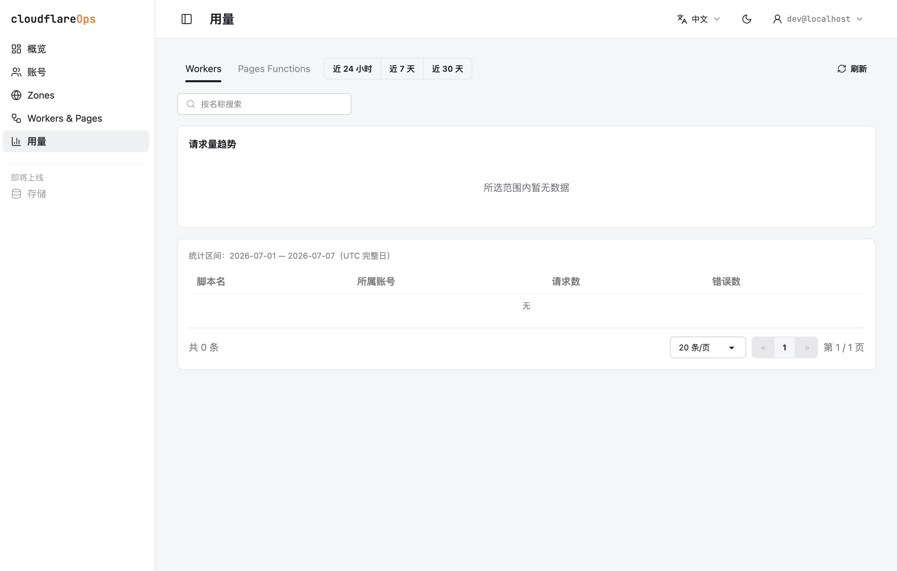

# cloudflareOps

[English](./README.md) | **简体中文** | [FAQ](./FAQ.zh-CN.md)

一个自托管的 **Cloudflare 多账号汇总管理平台**。通过 API Token 或 Cloudflare OAuth 连接账号，在一个界面里聚合管理 Zones、DNS、Workers、Pages、R2 存储、D1 数据库、用量分析与邮件发送，并使用 Cloudflare Access 保护后台。

技术栈为 Astro 7 + React + DaisyUI，部署于 Cloudflare Workers + D1。界面支持中英双语（页头右上角下拉切换，cookie 记忆，默认按浏览器语言）。

## 功能特性

- **多账号汇总** —— 为任意数量的 Cloudflare 账号添加 API Token，或通过带 PKCE 的 public OAuth client 授权连接；支持连接健康检查、搜索/分页与统一管理。凭证加密存储并按用户去重，OAuth access token 过期后自动刷新。
- **概览仪表盘** —— 快速查看账号健康状态、缓存的 Zone 总数、Workers 脚本数、Pages 项目数与最近同步状态。
- **Zones 与 DNS 管理** —— 跨账号同步 Zones，按域名/状态/账号过滤，查看 Zone 元数据，并通过 Cloudflare API 创建、更新、删除 DNS 记录。
- **Workers 管理** —— 聚合查看多账号脚本，查看绑定/配置/版本/部署历史，支持单模块源码查看与编辑，并在 Token 具备写权限时管理 cron、secrets、workers.dev URL 与自定义域。
- **Pages 管理** —— 浏览 Pages 项目，查看部署/日志/域名，触发部署、重试/回滚部署、清理构建缓存，并可挂载自定义域及按需创建 DNS 记录。
- **R2 存储管理** —— 跨账号同步存储桶，支持建桶/删桶；对象浏览器带文件夹导航与分页，上传下载走预签名 S3 URL 浏览器直连（零服务器中转），下载为强制附件。对象可应用内预览——图片、文本/代码、Markdown（sandbox 隔离渲染）、PDF、视频/音频，文本类经服务端中转、上限 1 MB。桶设置涵盖公开访问（r2.dev 与自定义域）、CORS、生命周期规则，每个桶还有存储量与 A/B 类操作用量图表。
- **D1 数据库管理** —— 跨账号同步 D1 数据库，支持创建（可选主副本区域提示）与输名确认删除。每个库有详情页：表浏览（表结构与行数）、SQL 查询控制台（参数绑定、多语句批、写语句执行前二次确认、本地查询历史）与读复制开关。
- **用量分析** —— Workers 与 Pages Functions 调用统计，支持近 24 小时逐时快照、7 天/30 天自然日快照、表格搜索、账号过滤与趋势图。完整区间（包括零流量时间桶）会缓存到 D1，普通切换区间不再重复请求 Cloudflare API；点击刷新时才显式重建所选区间。
- **邮件发送** —— 配置已验证的发送域名，底层可选 [Resend](https://resend.com/)（存储 API Key）或 Cloudflare Email Sending（复用已有账号凭证），即可在后台撰写并发送邮件。Cloudflare 域名可通过 API 完成 onboarding 和所需 DNS 记录添加。正文支持 Markdown / HTML / 纯文本并带实时预览；每次发送（成功或失败）都会写入支持搜索的审计记录，随后可查看并按原文重新渲染。
- **Cloudflare Access 登录认证** —— 使用 Cloudflare Access 保护后台，每个请求校验 `Cf-Access-Jwt-Assertion` JWT，并将认证邮箱作为用户数据隔离边界。
- **按用户隔离** —— 所有用户数据查询都按登录邮箱过滤，一个 Access 用户无法看到另一个用户的账号与缓存。
- **稳健同步模型** —— Cloudflare 上游数据缓存到 D1，按账号原子刷新；单个 Token 失效会记录为该账号失败，不阻塞其他账号同步。
- **双语与移动端友好** —— 默认简体中文，英文页面位于 `/en`；主要视图按窄屏适配，避免整页横向滚动。

## 界面截图

| 概览 | Workers & Pages |
| --- | --- |
|  |  |

| Zones | 用量分析 |
| --- | --- |
|  |  |

## 技术栈

- **运行时与框架** —— [Astro 7](https://astro.build/) SSR，使用 [Cloudflare adapter](https://docs.astro.build/en/guides/integrations-guide/cloudflare/) 面向 Cloudflare Workers / workerd。
- **交互界面** —— [React 19](https://react.dev/) islands 承载功能面板，[Tailwind CSS 4](https://tailwindcss.com/) 与 [DaisyUI 5](https://daisyui.com/) 构建设计系统，[lucide-react](https://lucide.dev/) 提供图标，[Recharts](https://recharts.org/) 绘制用量图表。
- **Cloudflare 平台** —— [Cloudflare Workers](https://developers.cloudflare.com/workers/) 托管，[D1](https://developers.cloudflare.com/d1/) 作为 SQLite 存储，[Cloudflare Access](https://developers.cloudflare.com/cloudflare-one/policies/access/) 提供 Zero Trust 认证。
- **认证流水线** —— Astro middleware 使用团队 JWKS 校验 Access JWT，将认证邮箱写入 `locals.userEmail`，本地开发提供带护栏的 `DEV_MODE` 旁路，并通过 `/cdn-cgi/access/logout` 退出 Access 会话。
- **Cloudflare 集成** —— 官方 [`cloudflare`](https://github.com/cloudflare/cloudflare-typescript) SDK 由本地 `CfClient` 统一封装；SDK 覆盖不完整的端点通过 REST 与 GraphQL fallback 处理。
- **存储与安全** —— D1 缓存表映射 Cloudflare API 资源；API Token 使用 AES-GCM 加密，另以 SHA-256 hash 做重复 Token 检测。
- **路由与本地化** —— Astro 文件路由，API 位于 `src/pages/api`，轻量 i18n 层负责中英文路由与文案。
- **质量工具** —— [Vitest](https://vitest.dev/) 单元测试，基于 `better-sqlite3` 的内存 D1 测试替身会执行真实迁移；同时使用 `astro check` + TypeScript，以及 [Biome](https://biomejs.dev/) 做 lint/format。

## 环境要求

- Node.js **>= 22.12.0**
- 一个可用 Workers、D1、Zero Trust（Access）的 Cloudflare 账号
- [Wrangler](https://developers.cloudflare.com/workers/wrangler/)（已作为开发依赖安装）

## 本地开发

> 项目可以使用 npm 或 pnpm，但同一个 `node_modules` 不要混用两套包管理器。仓库已包含 `pnpm-lock.yaml`，推荐本地日常开发使用 pnpm。

1. 安装依赖：
   ```bash
   pnpm install
   ```
   如果 pnpm 提示忽略了依赖构建脚本，请批准这些 native / runtime 包并重新构建：
   ```bash
   pnpm approve-builds better-sqlite3 esbuild workerd sharp
   pnpm rebuild
   ```
   `better-sqlite3` 用于本地 D1 测试替身和开发 D1 绑定；`esbuild` / `workerd` / `sharp` 由 Astro 与 Cloudflare 工具链使用。如果你选择 npm，请使用 `npm install`，并且不要和 pnpm 生成的 `node_modules` 混用。
2. 创建你的 Wrangler 配置（已 gitignore）：
   ```bash
   cp wrangler.toml.example wrangler.toml
   ```
   本地 D1 用默认的 `database_id` 占位符即可；只有远程部署才需要填真实 id。
3. 复制示例环境文件，并生成随机 `ENCRYPTION_KEY`：
   ```bash
   cp .dev.vars.example .dev.vars
   node -e "console.log(require('crypto').randomBytes(32).toString('hex'))"
   ```
   将生成的值填入 `.dev.vars` 的 `ENCRYPTION_KEY`。本地开发请保留 `DEV_MODE=true`，并保持 `CF_ACCESS_*` 不设置。
4. 创建本地 D1 数据库并执行迁移：
   ```bash
   pnpm run db:migrate
   ```
   迁移文件在 `migrations/`，新增变更按 `NNNN_描述.sql` 追加。
5. 启动开发服务器（Astro dev，带 HMR）：
   ```bash
   pnpm run dev
   ```
   运行在 4321 端口，带实时 D1 绑定（由 `better-sqlite3` 支撑）并加载 `.dev.vars`；`DEV_MODE=true` 旁路 Cloudflare Access 供本地开发。

   如需在本地通过 Workers 运行时验证生产构建，使用 Wrangler：
   ```bash
   pnpm run build
   pnpm run preview
   ```

6. 提交前运行标准检查：
   ```bash
   pnpm run typecheck
   pnpm run test
   ```

常见本地问题见 [FAQ](./FAQ.zh-CN.md)，包括 `better_sqlite3.node` binding 缺失和 Access 相关 403。

> **注意：** `DEV_MODE` 旁路与 Access 配置互斥（安全护栏）。两者同时存在时旁路会被禁用，导致本地 403。本地请勿设置 `CF_ACCESS_*`。

## 部署

1. 创建你的 `wrangler.toml`（它被 gitignore，因为含你自己的 database id）：
   ```bash
   cp wrangler.toml.example wrangler.toml
   ```
   然后创建远程 D1 数据库，将输出的 `database_id` 填入 `wrangler.toml`：
   ```bash
   wrangler d1 create cloudflareops-db
   ```
2. 对远程数据库执行迁移：
   ```bash
   npm run db:migrate:remote
   ```
3. 在 Cloudflare **Zero Trust** 控制台创建 Self-hosted **Access** 应用，域名指向 Worker 域名或绑定的自定义域。由此拿到应用需要的两个 Access 值：

   | 变量 | 在哪里取值 |
   | --- | --- |
   | `CF_ACCESS_TEAM_DOMAIN` | 你的团队域名 `<你的团队>.cloudflareaccess.com`。位置：Zero Trust → **Settings → Custom Pages**（或你登录 Zero Trust 时的地址）。填完整主机名，如 `acme.cloudflareaccess.com`，**不带** `https://`。 |
   | `CF_ACCESS_AUD` | Zero Trust → **Access → Applications → （你的应用）→ Overview**，字段 **Application Audience (AUD) Tag**，一串长十六进制。 |

4. 在 **Worker** 上设置这三个运行时值（生产环境**不要**设置 `DEV_MODE`）。`ENCRYPTION_KEY` 必须作为 Secret；Access 两项可用 Secret 或 Wrangler 普通变量：

   - **控制台：** Compute（Workers）→ 你的 Worker → **Settings → Variables and Secrets**。
   - **命令行：**
     ```bash
     npx wrangler secret put ENCRYPTION_KEY
     npx wrangler secret put CF_ACCESS_TEAM_DOMAIN
     npx wrangler secret put CF_ACCESS_AUD
     ```

   | 变量 | 值 |
   | --- | --- |
   | `ENCRYPTION_KEY` | 本地开发生成的那个 64 位十六进制密钥（或另生成一个） |
   | `CF_ACCESS_TEAM_DOMAIN` | 如 `acme.cloudflareaccess.com` |
   | `CF_ACCESS_AUD` | 第 3 步的 AUD 标签 |

   > **重要：** `CF_ACCESS_TEAM_DOMAIN` 与 `CF_ACCESS_AUD` 是应用的认证闸门。生产环境缺任一项 → 返回 **500 "Cloudflare Access not configured"**；请求不带有效 Access JWT → 返回 **403**。另外确保 Access 应用的域名与 Worker 域名或自定义域一致，否则 JWT 的 audience/issuer 校验会失败。
5. 可选：在 Cloudflare **Manage Account → OAuth clients** 注册 self-managed OAuth client，以启用账号页的“用 Cloudflare 授权”：

   - 客户端类型：public client，不使用 client secret。
   - Token endpoint authentication method：`None`。
   - PKCE：必须启用，方法为 `S256`。
   - Grant types：`authorization_code`、`refresh_token`；Response type：`code`。
   - Redirect URI：`https://<你的 Worker 域名>/api/accounts/oauth/callback`。
   - OAuth Client 允许的 scopes 必须完整包含 `CF_OAUTH_SCOPES` 请求的每一项；需要 refresh token 时加入 `offline_access`。不要添加不受支持的 OIDC `openid`，也不要使用无效的 `account.read`。
   - 邮件域名 onboarding 需要 `email-sending.read` 与 `email-sending.write`，应用会自动追加这两项必需权限。

   配置以下运行时变量。未设置 `CF_OAUTH_CLIENT_ID` 时 OAuth 入口自动隐藏，手动 API Token 方式仍可使用。

   | 变量 | 值 |
   | --- | --- |
   | `CF_OAUTH_CLIENT_ID` | OAuth client ID |
   | `CF_OAUTH_REDIRECT_URI` | 与注册值完全一致的回调地址；缺省时按请求 origin 推导 |
   | `CF_OAUTH_SCOPES` | 与 OAuth Client 允许列表一致、以空格分隔的 Cloudflare scope ID |

   完整 scope 示例见 [`.dev.vars.example`](./.dev.vars.example)。access token 与 refresh token 都会加密保存到 D1，access token 过期后自动刷新。
6. 部署：
   ```bash
   npm run deploy
   ```
   该命令先构建 Astro，再通过 `wrangler deploy` 发布。使用仓库自动部署时，可在 Workers Builds 中设置构建命令 `npm run build`、部署命令 `npx wrangler deploy`。

## 账号授权要求

账号可以通过手动 API Token 或上述可选 OAuth client 连接。两种方式都由实际授予的权限决定功能范围。建议的最小权限：

- **Zones / DNS：** Zone → Zone: Read；Zone → DNS: Edit
- **Workers & Pages：** Account → Account Settings: Read（解析 Token 归属账号）、Account → Workers Scripts: Read、Account → Cloudflare Pages: Read
- **可选 —— Pages 写操作**（部署重试/回滚、域名管理、触发部署、清缓存）：Account → Cloudflare Pages: **Edit**
- **可选 —— Workers 写操作**（在线编辑部署、cron、secrets、自定义域）：Account → Workers Scripts: **Edit**
- **可选 —— 用量页**（Workers/Pages Functions 调用数）：Account → Account Analytics: Read
- **可选 —— R2 存储：** Account → Workers R2 Storage: Read 即可浏览桶/对象、预览与下载（预签名 S3 凭证由 Token 派生，传输同样受 Token 的 R2 权限约束）；上传、删除对象、建桶/删桶与设置修改需要 **Edit**。桶用量 tab 另需 Account Analytics: Read。
- **可选 —— D1 数据库：** Account → D1: Read 即可同步/列出数据库、查看详情、浏览表结构与执行只读查询；建库/删库、查询控制台里的写语句、读复制开关需要 **Edit**。
- **可选 —— 通过 Cloudflare 发信**（仅当配置 Cloudflare 底层的发送域名时需要；Resend 域名用独立的 API Key，无需 Cloudflare 权限）：Account → Email Sending: Edit。且该域名需先在你的 Cloudflare 账号中完成发送验证。

说明：

- 查看类功能 Read 权限即可；缺 Edit 时对应按钮报 403 错误提示，不影响其他功能。
- 缺 Workers/Pages 权限的账号在同步时按账号记录失败（详见账号页），不影响其他账号。

## 脚本

下表以 `npm run` 展示，因为它们都是 package scripts；使用 pnpm 时执行 `pnpm run <script>` 即可。

| 脚本 | 说明 |
| --- | --- |
| `npm run dev` | Astro 开发服务器（`DEV_MODE` 旁路 Access） |
| `npm run build` | 生产构建 |
| `npm run preview` | 使用 `wrangler dev` 预览生产构建 |
| `npm run deploy` | 构建并部署到 Cloudflare Workers |
| `npm run typecheck` | `astro check` + `tsc --noEmit` |
| `npm run lint` | 运行 Biome lint |
| `npm run format` | 用 Biome 格式化文件 |
| `npm run check` | 运行 Biome check 并写入安全修复 |
| `npm run check:ci` | 以 CI 模式运行 Biome |
| `npm run test` | 运行 Vitest 测试 |
| `npm run db:migrate` | 本地执行 D1 迁移 |
| `npm run db:migrate:remote` | 对远程执行 D1 迁移 |

## 项目结构

```
src/
  components/   React island 面板（Accounts、Zones、DNS、Workers、Pages、R2、D1、Usage、Email、Dashboard）
  pages/        Astro 路由 + API 端点（src/pages/api）
  server/       服务端服务（usage、sync、r2、d1、email 等）
  lib/          共享工具（Cloudflare 客户端、加密 ...）
  i18n/         中英文案
  middleware.ts Access 认证
migrations/     D1 SQL 迁移（NNNN_描述.sql）
tests/          Vitest 单元测试
```

## 贡献

欢迎提交 Issue 和 Pull Request。提交前请运行 `pnpm run typecheck` 与 `pnpm run test`。

## 许可证

[MIT](./LICENSE) © 2026 bearboy80
